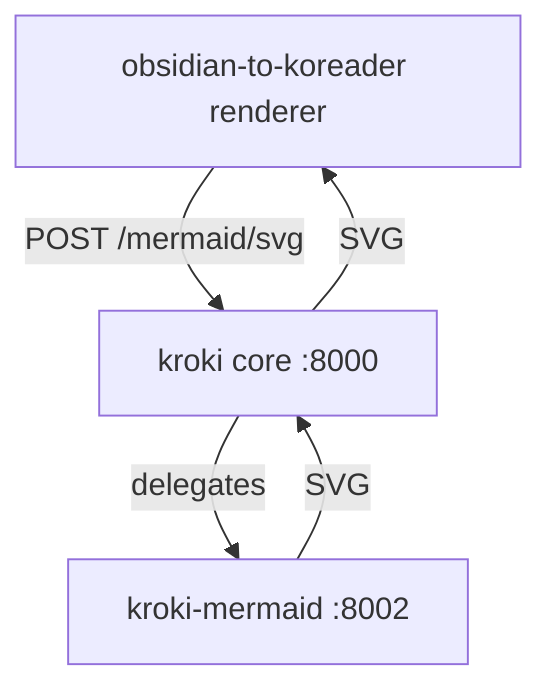

# Kroki — internal diagram renderer

A unified HTTP API that turns plain-text diagram source into images. It is **internal
only**: no Traefik router, no published port, no ingress. The only consumer today is
[[obsidian-to-koreader]], which POSTs each `mermaid` code block to Kroki at PDF build time
and embeds the returned SVG. If Kroki is unreachable the renderer falls back to the diagram
source text, so a Kroki outage never fails a note.

`core` (the Vert.x API, port 8000) delegates Mermaid rendering to the `mermaid` companion
(headless Chromium, port 8002) via `KROKI_MERMAID_HOST`. Only the Mermaid companion is
deployed; BPMN/Excalidraw are not. Both run on the shared docker network **`kroki_default`**,
which this stack creates and the renderer joins as an external network.



**Related:** [[kdk-dkr-01]] · [[obsidian-to-koreader]]

## At a glance

| Field | Value |
|---|---|
| Purpose | Render diagram source (Mermaid) → SVG for other lab jobs, in-cluster only |
| URL | — (no ingress; reached over the `kroki_default` docker network as `http://kroki:8000`) |
| Host | [[kdk-dkr-01]] |
| Stack | `stacks/kroki` (`kroki` core + `kroki-mermaid` companion) |
| Images | `yuzutech/kroki`, `yuzutech/kroki-mermaid` (pinned tag + `@sha256`; Renovate-tracked) |
| Data | none (stateless; renders in `/tmp`) |
| Deploy | Komodo stack `kroki` (always-on, `restart: unless-stopped`); **deploy before `obsidian-to-koreader`** |
| Blast radius | Mermaid diagrams in rendered PDFs fall back to source text; nothing else affected |

## Verify / test

Kroki is only reachable on the `kroki_default` network. Test it with a throwaway curl
container on that network (from `kdk-dkr-01`):

```bash
# health
ssh kdkadmin@10.1.20.20 'sudo docker run --rm --network kroki_default \
  curlimages/curl:8.11.1 -s http://kroki:8000/health'
# render a tiny Mermaid diagram -> SVG (expect a "<svg" prefix)
ssh kdkadmin@10.1.20.20 "sudo docker run --rm --network kroki_default \
  curlimages/curl:8.11.1 -s -XPOST --data-binary 'flowchart TD
A-->B' http://kroki:8000/mermaid/svg | head -c 80"
```

To reach it from the host without a helper container, read the container IP
(`sudo docker inspect -f '{{range .NetworkSettings.Networks}}{{.IPAddress}}{{end}}' kroki`)
and curl `http://<ip>:8000/health` — the docker bridge subnet is routable on its own host.

## Dependencies

| Direction | Thing | What breaks without it |
|---|---|---|
| Needs | the `mermaid` companion (same stack) | Mermaid rendering fails (core returns an error) |
| Needed by | [[obsidian-to-koreader]] (POSTs `mermaid` blocks) | diagrams fall back to source text in the PDFs |

## Observability

No dashboard. Logs ship to Loki via the observability agent. No secrets, no persistent
state. `core` carries a `/health` healthcheck; the `mermaid` companion a TCP liveness check
(see the compose comments — the first deploy should be confirmed healthy, and the core probe
tool adjusted if the image lacks `wget`).

## Architecture

Two pulled images on `kdk-dkr-01`, hardened to the compose baseline
(`docs/reference/compose-baseline.md`): `no-new-privileges`, `cap_drop: ALL`, pinned
tag+digest, pids/mem limits, log rotation. `core` runs `read_only` with a `/tmp` tmpfs; the
`mermaid` companion keeps a writable rootfs (documented `kdk.baseline.skip: read_only`)
because the headless Chromium it drives writes profile/crashpad dirs across the filesystem,
and gets a larger `/dev/shm` (`shm_size: 256m`) and `init: true` to reap Chromium children.
`KROKI_SAFE_MODE=secure` keeps the API's surface minimal (it only ever renders trusted vault
diagrams).

## Configuration

| Path / setting | What it is |
|---|---|
| `stacks/kroki/compose.yaml` | both services, `KROKI_MERMAID_HOST=mermaid`, the named `kroki_default` network |
| `komodo/resources.toml` | the `kroki` stack (server `kdk-dkr-01`, pulled images, no secrets) |
| `stacks/advisory-watch/catalog.json` | advisory sources for both images |

## Secret Rotation

None — Kroki has no secrets.
