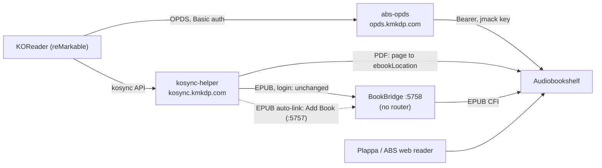

# Reading sync (OPDS + KOReader progress)

Audiobookshelf (ABS) is the only book library. This stack lets KOReader on the reMarkable
download books from ABS and keep its reading position in sync with the phone (Plappa, the ABS
web reader), for EPUB and PDF. It runs on kdk-dkr-dmz-01 next to [Audiobookshelf](audiobookshelf.md).
Both hostnames are **LAN + tailnet only**: the routers are on the DMZ Traefik `websecure`
entrypoint, never `tunnel`, and neither has a Cloudflare public hostname.



## At a glance

| Field | Value |
|---|---|
| Purpose | OPDS catalogue of the ABS `ebooks` library for KOReader, and KOReader Progress sync to ABS for EPUB and PDF |
| Host | kdk-dkr-dmz-01 (192.168.191.20), Komodo stack `reading-sync` |
| URLs | `https://opds.kmkdp.com/opds` (catalogue), `https://kosync.kmkdp.com` (sync server). Both LAN + tailnet |
| Services | `abs-opds` (ghcr.io/vito0912/abs-opds 2.0.7), `kosync-helper` (local build, `stacks/reading-sync/kosync-helper`), `bookbridge` (ghcr.io/cporcellijr/bookbridge 7.12.0) |
| Identity | One reader: `jmack`. Three ABS API keys, all for `jmack`, each with an expiry (one per service, so each can be revoked alone) |
| Storage | BookBridge DB + `secret.key` in `/opt/kdk-lab/reading-sync/bookbridge` (local disk). Ebooks read-only from `/mnt/media/books/ebook` |
| Blast radius | Down: no new downloads on the tablet and no position sync. Books already on the tablet still open. ABS and the phone are unaffected |

### What each piece does

- **abs-opds** lists the `ebooks` library as an OPDS feed. `USE_PROXY=true`: every download
  streams through it with the ABS key in a header, so no link on the tablet carries the key. The
  files are byte-identical to the library, so KOReader's **Binary** document hash is the same one
  BookBridge and the helper compute.
- **kosync-helper** is the sync server KOReader talks to. It speaks the KOReader kosync API and
  serves only `/users/create`, `/users/auth`, `/users/login`, `/healthcheck`, `PUT /syncs/progress`
  and `GET /syncs/progress/<doc>`. Any other path returns 404 and never reaches BookBridge.
  - **PDF** (the hash belongs to an item in the ABS `ebooks` library whose primary ebook is a PDF):
    the helper writes ABS itself: `ebookLocation` = the page, `ebookProgress` = (page − 1) / pages,
    and `isFinished` at the last page. On a pull it answers from ABS in kosync format. Same file,
    same page count, so page N on the tablet is page N in ABS.
  - **Everything else** (EPUB, register, login): passed to BookBridge unchanged.
  - **EPUB auto-link**: when BookBridge has accepted a `jmack` PUT for an EPUB in the map and has
    no link for that hash, the helper creates the ebook-only link itself (see EPUB auto-link
    below).
  - **Hash map**: the helper computes KOReader's partial MD5 of every primary PDF (plus its page
    count) and every primary EPUB in the library from the read-only mount, at start and then
    hourly.
  - **Auth**: BookBridge's. Before a PDF read or write the helper checks the device's login with
    BookBridge `/users/auth` and caches a success for 5 minutes. Only the login `jmack` can use the
    PDF path, because the helper's ABS key acts as `jmack`.
- **BookBridge** syncs EPUB positions: KOReader's xpointer becomes an ABS EPUB CFI and back, as
  ebook-only links. It finds a new EPUB hash in `/books`, but in 7.12.0 it never links it on its
  own while ABS is configured: its discovery searches every ABS item (it ignores
  `ABS_LIBRARY_ID`), finds the EPUB's own ABS ebook item, and saves a suggestion instead. The
  helper's auto-link fills that gap. Auto-mapping to an audiobook is off
  (`KOSYNC_AUTO_MAP_ON_AGREEMENT=false`).

## Verify

```bash
ssh kdkadmin@192.168.191.20 'sudo docker ps --filter name=abs-opds --filter name=kosync-helper --filter name=bookbridge --format "{{.Names}} {{.Status}}"'
curl -s https://kosync.kmkdp.com/healthcheck                  # OK (BookBridge, through the helper)
curl -s -o /dev/null -w '%{http_code}\n' https://opds.kmkdp.com/opds   # 401 (needs Basic auth)
ssh kdkadmin@192.168.191.20 'sudo docker exec kosync-helper python -I -c "import urllib.request;print(urllib.request.urlopen(\"http://127.0.0.1:8080/health\").read().decode())"'
#   {"pdfs": 23, "epubs": <n>, "epub_autolink": true, "map_loaded": true, "status": "ok"}
```

The PDF count matches the library: 23 items whose primary ebook is a PDF (2026-11-10).
`epub_autolink: false` means the helper has no BookBridge password (auto-link off).

## KOReader setup (tablet)

Built-in KOReader features only, nothing installed, so the reManager rule holds. The tablet needs
Wi-Fi and Tailscale up (the subnet router carries 192.168.191.0/24).

1. **Get the two passwords** on the laptop: `op read "op://kdk-cluster/abs-opds-jmack/password"`
   (catalogue) and `op read "op://kdk-cluster/bookbridge-kosync-jmack/password"` (sync). Type them
   on the tablet; never paste them anywhere else.
2. **OPDS catalogue.** Triple-press → AppLoad → KOReader. In the file browser: magnifier icon
   (Search) → **OPDS catalog** → **+**.
   - Catalog name `Audiobookshelf`, URL `https://opds.kmkdp.com/opds`, Username `jmack`,
     Password = the catalogue password.
   - If the catalogue answers "Authentication required", edit it: URL
     `https://jmack:<password>@opds.kmkdp.com/opds` and leave the username and password fields
     empty (the abs-opds README form).
   - Delete the old Calibre catalogue entry (long-press it → Delete): Calibre is retired.
3. **Progress sync.** Open any book → top menu → Tools (wrench) → **Progress sync**:
   - **Custom sync server**: `https://kosync.kmkdp.com` (base URL only, no path).
   - **Register / Login** → **Login** with `jmack` and the sync password. **Register** also
     succeeds, but only because the account already exists: BookBridge never creates accounts.
   - **Document matching method**: **Binary**.
   - **Auto sync**: on. KOReader then pushes on page turns (every N pages), on close and on
     suspend, and pulls on open and resume.
   - **Sync to a newer state**: Silent (or Prompt). **Sync to an older state**: Prompt.
4. **Re-download the EPUBs you are reading** from the new catalogue. Calibre (retired) stamped
   metadata into every EPUB it served, so an old Calibre copy has a different hash and never
   syncs. Calibre's PDFs are unchanged (25/25 measured), so PDFs already on the tablet match
   without a re-download.
   - Re-downloading many books in 15 minutes can fire the `AbsMassDownload` alert (more than 10
     downloads from one client). That is expected once; the client is the abs-opds container.

## Plappa (phone)

Plappa signs in to `https://audiobookshelf.kmkdp.com` as `jmack` (Authelia OIDC, scheme
`plappa://oauth`, see [Audiobookshelf](audiobookshelf.md)). Progress is per ABS user, so the phone
and the tablet must both be `jmack`.

- **EPUB**: ABS keeps one position field. BookBridge writes CFI, which the ABS web reader and the
  official apps use. If Plappa opens EPUBs at the start or at the wrong place, it writes a
  different format: set **BookBridge → Settings → Sync Behavior → ABS Ebook Position Format** to
  `auto` (the env value only seeds the first boot).
- **PDF**: not verified whether Plappa opens PDFs or writes `ebookLocation`. The ABS web reader
  does (page number), so use it for PDFs if Plappa does not.

## One-time MOBI conversion

One book in `/mnt/media/books/ebook` exists only as MOBI: **L. David Marquet, *Turn The Ship
Around!*** (the other three MOBIs have an EPUB beside them). KOReader opens MOBI but neither sync
path handles it, so convert it once to EPUB in the library. The DMZ mounts the library
read-only, so run it on kdk-dkr-01 (LazyLibrarian's side, where the library is writable), with
Calibre's `ebook-convert` from the `kdk/readwise-koreader` image, as uid 1000 (the files' owner),
with no network. That image is left over from the retired readwise-koreader job and is the only
image on dkr-01 with `ebook-convert`; the post-retirement host cleanup keeps it until this
conversion is done (the EPUB exists):

```bash
ssh kdkadmin@10.1.20.20
D="/mnt/media/books/ebook/L. David Marquet/Turn The Ship Around!"
sudo docker run --rm --network none --user 1000:1000 -e HOME=/tmp --tmpfs /tmp \
  -v "$D:/book" --entrypoint ebook-convert kdk/readwise-koreader:latest \
  "/book/Turn The Ship Around! - L. David Marquet.mobi" \
  "/book/Turn The Ship Around! - L. David Marquet.epub"
ls -la "$D"
```

Then let ABS pick the file up (the `ebooks` library scans at minute 15 of every hour, or run a
scan) and, in ABS → the book → **Files**, make the EPUB the primary ebook if ABS kept the MOBI as
primary. Keep the MOBI; LazyLibrarian owns the folder.

## BookBridge admin UI

No router and no published port. Reach it through an SSH tunnel to its container address:

```bash
ssh kdkadmin@192.168.191.20 "sudo docker inspect -f '{{(index .NetworkSettings.Networks \"proxy-dmz\").IPAddress}}' bookbridge"
ssh -N -L 5757:<that address>:5757 kdkadmin@192.168.191.20   # then open http://localhost:5757
```

The first visit creates the admin account. Do it right after the first deploy (until then any
container on `proxy-dmz` could claim it), with the password from the `bookbridge-admin` item in
`kdk-ops`. Then check **Account → My Integrations**: the Audiobookshelf card has the token and
library `ebooks`, and the KOReader/KoSync card has user `jmack`. Use each card's **Test** button.

## EPUB auto-link

Read forward in an EPUB downloaded from the catalogue and it links itself; nothing to do in
BookBridge. How it works, after a `jmack` PUT that BookBridge accepted:

1. The hash is in the helper's EPUB map (a primary EPUB of the `ebooks` library). PDFs and
   unknown hashes never get here.
2. The helper signs in to the BookBridge web UI as `kdkadmin` (`http://bookbridge:5757`, the
   internal network) and reads `/api/me/books` and `/api/me/kosync-documents`. A hash that is
   already linked is left alone. An ABS item that already has a book with another hash is left
   alone too (`epub_mapping_conflict`).
3. It checks the item in ABS (in the `ebooks` library, a book with no audio files, primary ebook
   an EPUB at the mapped path and size) and re-hashes the file on the mount. Any mismatch:
   `epub_mapping_refused`, retried after the next hourly map refresh.
4. It makes the Add Book submit (`POST /match`: no audiobook, ebook `<item>_abs.epub`, source
   ABS), the same request as doing it by hand, then checks that the new book carries the hash:
   `epub_mapping_created`.

One attempt per hash at a time. A failure waits 60 s, doubling to 6 h. A refused login pauses
every hash for 15 minutes, so the helper never reaches BookBridge's 5-failures-a-minute login
limit. The helper never writes BookBridge's database and never touches an audiobook.

Why `kdkadmin`: BookBridge links books per account, and the KOSync login `jmack` (the global
`KOSYNC_USER`) belongs to the primary admin. A link made by any other account is invisible to the
tablet. BookBridge 7.12.0 has no API token for links (`ADMIN_API_TOKEN` only manages reader
accounts), and a reader account has no ABS key to hash the `_abs` ebook with.

### One-time setup (before the merge)

The `pre_deploy` fails while the 1Password item is missing, so do this first.

1. Create the helper's item with a new password (letters and digits only):

   ```bash
   op item create --vault kdk-cluster --category login --title kosync-helper-bookbridge-login \
     username=kdkadmin --generate-password=letters,digits,32 >/dev/null
   ```

2. Make it kdkadmin's BookBridge password. Open the UI over the tunnel (BookBridge admin UI,
   above) → **Account**. Current password = the `bookbridge-admin` item in `kdk-ops`. New and
   Confirm = the new item's password, copied from the 1Password app. **Save changes**.
3. Store the same value in the owner's item, so both stay right:

   ```bash
   op item edit bookbridge-admin --vault kdk-ops \
     "password=$(op read 'op://kdk-cluster/kosync-helper-bookbridge-login/password')" >/dev/null
   ```

4. Sign out and back in to the UI with the new password, then merge. The deploy renders
   `KOSYNC_HELPER_BOOKBRIDGE_PASSWORD`, and `/health` shows `"epub_autolink": true`.

### Linking by hand (fallback)

If an EPUB still does not sync (the helper log shows `epub_mapping_refused` or
`epub_mapping_failed`), link it in the UI:

1. **Add Book**. Search for the title only, without the ISBN in brackets that some file names
   carry (the search does not match it).
2. Audiobook: **None** (No audio).
3. Ebook: the result with the **ABS** badge (its file name is `<item id>_abs.epub`), not the
   `/books` file of the same name.
4. Add it and process the queue. The book shows on the dashboard as ebook only.

The **Library Suggestions** page (about 33 entries) is a separate scan of unmatched ABS items
looking for an audiobook partner. It has nothing to do with tablet sync: ignore it.

## Troubleshooting

| Symptom | Cause | Fix |
|---|---|---|
| KOReader "Something went wrong when syncing progress" | tablet offline or Tailscale down; or the helper or BookBridge is down | check Wi-Fi + Tailscale; `curl https://kosync.kmkdp.com/healthcheck` from the laptop; container status (Verify) |
| Login fails right after a wrong password | BookBridge refuses a login for a minute after five failures per tablet address | wait a minute, then log in with the 1Password value |
| An EPUB never syncs | the copy came from Calibre (different hash); or the auto-link did not run (`epub_autolink: false` in `/health`) or was refused | re-download from the OPDS catalogue; `sudo docker logs kosync-helper` for `epub_mapping_*` / `bookbridge_login_failed`; link it by hand (EPUB auto-link, fallback). Resolving the BookBridge suggestion does not create the link |
| `bookbridge_login_failed` in the helper log | kdkadmin's BookBridge password and `kosync-helper-bookbridge-login` differ | set them equal (EPUB auto-link, setup steps 2 and 3), redeploy |
| EPUB lands about 30 s behind | BookBridge waits `KOSYNC_PUT_DEBOUNCE_SECONDS` (30 s) after the last page turn, then syncs to ABS | expected; if it is minutes, check the UI value (Settings → KOReader: wait after the last page turn) is 30, not the default 300 |
| A PDF does nothing in ABS | the PDF is a supplementary file (the item's primary ebook is an EPUB), or it was added less than an hour ago, or the ABS key expired | read the same format on both sides; wait for the hourly refresh or restart the helper; `sudo docker logs kosync-helper` for `pdf_map_refresh_failed` / `pdf_put_failed` |
| Helper unhealthy (`/health` 503) | the hourly map refresh has failed for too long (ABS down, key expired or revoked) | `sudo docker logs --tail 50 kosync-helper`; renew the key (Secret Rotation) |
| Tablet jumps to the last page of a PDF | ABS holds a page beyond the end (another reader wrote it); the helper clamps to the last page | correct the page in the ABS web reader |
| A finished book shows unfinished, or the reverse | the helper sets `isFinished` only at the last PDF page and never clears it; EPUB finished state is BookBridge's | mark it in ABS (status lives in ABS) |
| BookBridge restarts with a write error | the image wrote outside `/data` and `/tmp` on the read-only rootfs | add the path as a `tmpfs` (or, if it must persist, a volume) in the compose and redeploy; drop `read_only` only with a `kdk.baseline.skip` label and a reason |
| OPDS "Authentication required" in KOReader | KOReader did not send the fields | use the URL form in KOReader setup step 2 |

## Dependencies

- [Audiobookshelf](audiobookshelf.md) at `http://audiobookshelf/audiobookshelf` on `proxy-dmz`.
- DMZ Traefik `websecure` ([Traefik DMZ](dmz-proxy.md)); dns-reconcile creates the two rewrites
  to 192.168.191.20 from the Host labels.
- The read-only media NFS mount `/mnt/media/books/ebook` on dmz-01.
- 1Password Connect for the Komodo `pre_deploy` (`op inject`).

## Observability

- Container logs → Alloy → Loki (`{container="kosync-helper"}` etc.). The helper logs JSON with
  the event, ABS item id, status and a fixed reason word only: no keys, passwords, users or
  document hashes. Events: `pdf_put`, `pdf_put_finished`, `pdf_get`, `pdf_get_empty`,
  `passthrough`, `auth_refused`, `pdf_map_refreshed`, `epub_map_refreshed`,
  `pdf_map_refresh_failed` and the `_timeout` / `_failed` variants. EPUB auto-link:
  `epub_autolink_enabled` / `_disabled` (start), `epub_mapping_created`, `epub_mapping_exists`,
  `epub_mapping_conflict`, `epub_mapping_refused`, `epub_mapping_failed`,
  `epub_mapping_hash_mismatch`, `bookbridge_login_failed`.
- Healthchecks: abs-opds (`/opds` answers 401), helper (`/health`), BookBridge (`:5758/healthcheck`).

## Architecture

- Networks: all three on `proxy-dmz` (Traefik in, ABS out). The helper and BookBridge also share
  `reading-sync` (internal, 10.211.40.0/24; the helper is pinned at .10). BookBridge has no
  Traefik labels, so the DMZ Traefik never routes it, but it is reachable on `proxy-dmz` by the
  other DMZ containers (its UI has its own login, and its KOSync routes need the sync login).
- `KOSYNC_TRUSTED_PROXIES` = the helper and DMZ Traefik, so BookBridge's login failure limit
  counts per tablet address (from `X-Forwarded-For`), not per proxy.
- Hardening: every service runs non-root (`abs-opds` 1000, helper 65532, BookBridge 1000), with
  `cap_drop: [ALL]`, `no-new-privileges`, a read-only rootfs, `/tmp` tmpfs, pids and memory limits.

## Configuration

| Item | Where |
|---|---|
| Image pins, env, routers | `stacks/reading-sync/compose.yaml` |
| Secret references | `stacks/reading-sync/.env.tpl` (rendered by the Komodo `pre_deploy`) |
| Helper code + tests | `stacks/reading-sync/kosync-helper/` (`uv run pytest`) |
| BookBridge settings after the first boot | the BookBridge UI. Env values only seed its settings DB once; `BOOKBRIDGE_SECRET_KEY` is env-only |
| KOReader → ABS delay | `KOSYNC_PUT_DEBOUNCE_SECONDS` = 30 s (UI: Settings → KOReader: wait after the last page turn; default 300) |

## Secret Rotation

Every secret lives in 1Password `kdk-cluster` (Connect reads only that vault), field `password`.
Rotation = update the item, then redeploy the stack (the `pre_deploy` re-renders `.env`;
`docker restart` alone does not re-read it).

| Item | Used by | Rotate |
|---|---|---|
| `abs-opds-abs-api-key` | abs-opds (`OPDS_USERS`) | new ABS key for `jmack` with an expiry (below), then deactivate the old key in ABS |
| `abs-opds-jmack` | the tablet's OPDS login | `op item edit abs-opds-jmack --vault kdk-cluster --generate-password=letters,digits,32`, redeploy, retype on the tablet |
| `kosync-helper-abs-api-key` | kosync-helper | as for abs-opds |
| `bookbridge-abs-api-key` | BookBridge first-boot seed | new key, then paste it in BookBridge → My Integrations → Audiobookshelf (the env only seeds the first boot) |
| `bookbridge-secret-key` | BookBridge credential encryption | do not rotate casually: a new key makes every stored login unreadable and you re-enter them |
| `kosync-helper-bookbridge-login` | kosync-helper (EPUB auto-link), = kdkadmin's BookBridge password | `op item edit kosync-helper-bookbridge-login --vault kdk-cluster --generate-password=letters,digits,32`, then EPUB auto-link setup steps 2 to 4 (Account page, `kdk-ops` copy, redeploy) |
| `bookbridge-kosync-jmack` | BookBridge `KOSYNC_KEY`, typed into KOReader | `op item edit bookbridge-kosync-jmack --vault kdk-cluster --generate-password=letters,digits,32`, redeploy, KOReader → Progress sync → Logout → Login |

A new ABS API key for `jmack`, with an expiry: ABS → Settings → API Keys → **Add API Key**, name
`<service>`, user `jmack`, expires 365 days, active. Copy the key once, then store it without it
touching the screen or the shell history:

```bash
read -rs ABS_KEY && op item edit <item> --vault kdk-cluster "password=$ABS_KEY"; unset ABS_KEY
```

Diary the expiry date: an expired key stops the catalogue (abs-opds), PDF sync (helper) or EPUB
sync (BookBridge), and the helper's `/health` turns 503 within about two hours.

## User Guide

- Read on the tablet as usual. Open a book with Wi-Fi + Tailscale on and it jumps (or asks) to
  where the phone left off; close it or let it sleep and the phone can continue from there.
- New books: they appear in the catalogue within the hour after LazyLibrarian imports them (ABS
  scans at minute 15).
- Highlights still go to the vault through `koreader-highlights`; this stack does not sync them.
