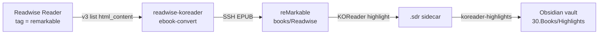

# readwise-koreader

Scheduled one-shot on **kdk-dkr-01** that mirrors tagged **Readwise Reader**
articles onto the reMarkable **as EPUB files for KOReader**, so they are read and
highlighted in KOReader and the highlights flow back to Obsidian through the
existing `koreader-highlights` job. Phase 1 of the `remarkable-readwise-app`
design. Revived 2026-10-30 (originally built 2026-09-18, retired 2026-10-29 for
never being live-validated).

**Related:** [[kdk-dkr-01]] · [[calibre]] · the `koreader-highlights`,
`obsidian-to-koreader` tablet jobs · `remarkable/README.md`

## At a glance

| Field | Value |
|---|---|
| Purpose | Tagged Readwise Reader docs → EPUB → tablet `/home/root/books/Readwise` for KOReader |
| Selection | Tag a doc `remarkable` in Reader (locations `new,later,shortlist`); untag/archive removes it next reconcile |
| URL | none (no ingress; outbound to `readwise.io` + SSH to the tablet) |
| Host | [[kdk-dkr-01]] |
| Stack | `stacks/readwise-koreader` (one service, local build) |
| Image | `kdk/readwise-koreader:latest` (built locally — `auto_pull = false`, `run_build = true`) |
| Transport | SSH to tailnet `remarkable-pp` (`100.103.233.103`), LAN `10.1.30.245` fallback; liveness = SSH echo (ICMP filtered) |
| State | `/opt/kdk-lab/readwise-koreader/readwise-koreader.json` (doc id → delivered filename) |
| Schedule | every 3h at `:10` America/Chicago, `readwise-koreader` procedure (`deploy = false`, `destroy_before_deploy`) |
| Secrets | `readwise-token-ro` (Reader v3), `remarkable-device` (tablet SSH) — op-injected to `.env` |
| Blast radius | new tagged articles don't reach the tablet; existing files + highlights unaffected |

## Round-trip



## Verify

```bash
# last run summary line in Loki (job=readwise-koreader)
# from a laptop with op, dry list against the live API (counts + titles only):
READWISE_TOKEN="$(op read op://kdk-cluster/readwise-token-ro/credential)" \
  python3 - <<'PY'
import os,json,urllib.request,urllib.parse
tok=os.environ["READWISE_TOKEN"]
for loc in ("new","later","shortlist"):
    q=urllib.parse.urlencode([("location",loc),("tag","remarkable")])
    r=urllib.request.Request("https://readwise.io/api/v3/list/?"+q,headers={"Authorization":f"Token {tok}"})
    d=json.load(urllib.request.urlopen(r))
    print(loc,len(d.get("results",[])),[x.get("title") for x in d.get("results",[])])
PY
# tablet side (when awake): list delivered EPUBs
sshpass -p "$(op read op://kdk-cluster/remarkable-device/password)" \
  ssh -o StrictHostKeyChecking=accept-new root@100.103.233.103 'ls -la /home/root/books/Readwise'
```

## Troubleshooting

| Problem | Cause | Command to validate |
|---|---|---|
| "tablet asleep/unreachable; skipping" | tablet off tailnet + LAN (asleep) | expected; reconciles next run. `ssh root@100.103.233.103 'echo ok'` when awake |
| Tagged article never appears | wrong location, or category not in `CATEGORIES` | the dry-list above; check the doc's location + category |
| `ebook-convert failed` | odd/empty `html_content`; bodyless pdf/epub doc | `docker logs readwise-koreader`; bodyless docs are skipped, not failed |
| Images missing in the EPUB | doc's HTML uses relative image URLs (common for `epub`/`pdf` category docs) | articles with absolute image URLs embed fine; see Architecture note |
| 429 from Readwise | LIST is 20/min | the job rate-limits every request (`THROTTLE_SECONDS`) and honours `Retry-After`; no action |

## Dependencies

| Direction | Thing | What breaks without it |
|---|---|---|
| Needs | Readwise Reader API v3 + `readwise-token-ro` | no source docs |
| Needs | tablet SSH (tailnet or LAN) + `remarkable-device` | nothing delivered |
| Needs | `ebook-convert` (Calibre, in the image) | no EPUB render |
| Needed by | `koreader-highlights` | it ingests the `.sdr` sidecars this stack's files produce |

## Observability

No dashboard. One summary line per run is pushed to Loki directly
(`{job="readwise-koreader", container="readwise-koreader", host="kdk-dkr-01"}`)
because a one-shot exits before Alloy can scrape it — same pattern as
`cloudflare-watch`. Pushover fires on a convert/deliver failure.

## Architecture

Local build (`python:3.12.16-slim` digest-pinned + apt `calibre` + `sshpass`),
same shape as `obsidian-to-koreader` / `koreader-highlights`. Each run: SSH-probe
the tailnet node then the LAN fallback; list Reader v3 `new,later,shortlist` with
the server-side `tag=remarkable` filter (re-checked client-side); render each
doc's `html_content` to EPUB with `ebook-convert`; SFTP-copy it under
`/home/root/books/Readwise`; reconcile against the state file (deliver new,
remove untagged — leaving `.sdr` so un-ingested highlights survive).

> **Image fidelity:** `ebook-convert` embeds images referenced by absolute URLs
> (typical of `category=article`/`pdf` Reader docs). A `category=epub` doc's
> scraped `html_content` tends to use *relative* image paths, which do not embed;
> such docs are better pulled via their original source and are a poor fit for the
> html-render path. Narrow `CATEGORIES` if you don't want books/pdfs mirrored.

## Configuration

| Path / setting | What it is |
|---|---|
| `stacks/readwise-koreader/compose.yaml` | service, env (`RM_HOST`, `RM_HOST_FALLBACK`, `LOCATIONS`, `TAG`, `LOKI_URL`) |
| `stacks/readwise-koreader/.env.tpl` | op refs: `READWISE_TOKEN`, `RM_PW` |
| `/opt/kdk-lab/readwise-koreader/` | state dir (doc-id → filename map) |
| Komodo procedure `readwise-koreader` | cron `0 10 */3 * * *` America/Chicago |

## Secret Rotation

`readwise-token-ro` and `remarkable-device` live in `op://kdk-cluster`. Rotate in
1Password; the next deploy's `pre_deploy` `op inject` re-renders `.env`. The
Readwise token is unscoped (the `-ro` is a naming convention); Phase 2 write-back
would use the same token.

## User Guide

In Readwise Reader, add the tag `remarkable` to any article (or remove it to pull
it back off the tablet). Within ~3 hours, when the tablet is awake, the article
appears in KOReader under `Readwise/`. Read and highlight it there; the highlights
reach the vault at `30.Books/Highlights` via `koreader-highlights`. Articles live
under `books/Readwise`, never inside the vault folders.
