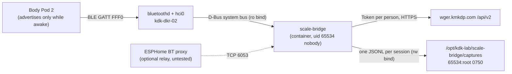

# scale-bridge (Body Pod 2 → wger)

A small Python service on kdk-dkr-02 that listens for the household scale (Hume
**Body Pod 2**, a Lefu OEM unit) over Bluetooth LE, decodes a weigh-in, works out whose
it is from a weight band, and writes it to that person's [wger](wger.md): body weight
plus the ten raw impedance values (and, behind a switch, the heart rate). It also keeps a
**raw capture file per weigh-in** for paired tests against the vendor app. It ships in **dry-run**: it logs what it would write
and posts nothing until the owner switches it on ([runbook](../runbooks/scale-bridge.md)).

No port, no UI, no Traefik router. It computes no body composition: the scale sends
weight and raw ohms only, and Hume's formulas are closed.



## At a glance

| Field | Value |
|---|---|
| Purpose | Body Pod 2 weigh-ins → wger body weight + raw impedance, per person |
| Host | kdk-dkr-02 (10.1.30.21), Komodo stack `scale-bridge` |
| Image | `kdk/scale-bridge:0.1.3`, built on the host from `stacks/scale-bridge` (python 3.12-slim, bleak, bleak-retry-connector, bleak-esphome, httpx from `uv.lock`) |
| Mode | `SCALE_BRIDGE_DRY_RUN: "true"` in compose until the owner flips it |
| Bluetooth | `/run/dbus:/run/dbus:ro` → host bluetoothd, as uid `65534:65534` (host `nobody:nogroup`). No privileged, no capabilities, no `/dev`, bridge network |
| Host files | `/opt/kdk-lab/scale-bridge/scale-bridge.env` (people bands, optional address/proxies), `/opt/kdk-lab/scale-bridge/secrets.env` (wger keys, noise keys). Both root 600, host-managed |
| Storage | `/opt/kdk-lab/scale-bridge/captures` → `/captures` (rw), `65534:root 0750`, created by the runbook before the deploy: raw capture files (health data, 0640, pruned after 60 days). Readings are not spooled: one that cannot reach wger after 6 tries (waits 30+60+120+240+480 s = 15.5 min) is logged as lost (`write_gave_up`) |
| Blast radius | Down: weigh-ins are not recorded (weigh again later, or enter in the wger app). wger and HA are unaffected |

## How a weigh-in flows

1. The scale wakes when someone steps on and advertises as `Body Pod 2` with service
   `FFF0`. The bridge scans all the time and matches on that name (or, for a nameless
   passive advert, on `FFF0`), plus `SCALE_ADDRESS` if set. Without `SCALE_ADDRESS` any
   nearby device with that name is accepted (startup logs `config_address_filter_off`);
   pinning it is a go-live step in the runbook.
2. Connect (bleak-retry-connector, 3 attempts, 30 s cap), subscribe `FFF4`, write the
   placeholder profile `FE 01 <sex> <activity> <height> <age> 01 <xor>` to `FFF1`, then
   subscribe `FFF2` (silent on our unit).
3. Collect frames. Every frame's last byte is the XOR of the others; a bad frame is
   counted and dropped.
   - **Settled weight** = the first `CF` frame with the stable bit and a non-zero weight.
     Every weight `CF` after it is ignored.
   - Then up to 5 s for both `BE` frames (≈50 kHz, ≈250 kHz; five values each, order
     right arm, left arm, trunk, right leg, left leg per the protocol reference), then
     up to 1 s for the four `DF` frames (kept raw).
   - Then up to 20 s (`SCALE_END_MARKER_WAIT_S`) for the **end-of-measurement marker**:
     a `CF` frame with the stable bit, weight 0 and state byte `00`, sent about 5 s after
     the lock as the load comes off, only when the handle was held. Byte 1 is the heart
     rate in BPM (0 = none). The session ends on the marker (`ended_by: end_marker`), a
     disconnect, or the wait (`end_marker_timeout`, heart rate none); either way the
     reading is complete. The vendor app appears to need this frame before it accepts a
     replayed weigh-in.
   - A lock without `BE` frames is still a reading (weight only, `impedance_timeout`, no
     marker wait). No lock = no reading; a marker before any lock (a step-off) is
     counted (`early_end_markers`) and changes nothing. The handle must be held to the
     end for a lock (~20 s). The 90 s session watchdog still caps everything.
4. Disconnect, then ignore the scale for 60 s: on a second connection it replays the
   same weight (and impedance). The cooldown is in memory only; after a restart the
   replay rule below is what keeps a replay from being written twice.
5. Attribution: exactly one band containing the weight = that person. No band or two
   bands = warning, nothing written. Bands are inclusive and given in pounds
   (`min_lb`/`max_lb`) or, still accepted, kilograms (`min_kg`/`max_kg`): one pair per
   person. Pounds are converted to kg once at startup; the comparison is in kg.
6. Dry-run: one `would_write` log line (`weight_kg` plus `weight_lb` to 0.1, to compare
   with the scale display; `heart_rate: true/false` = whether one was captured, never the
   value). Live: written to wger in the background; a failed attempt
   (wger error, timeout, a non-JSON or unexpected body, or any other exception) is
   retried after 30 s, doubling, 6 tries in all (15.5 min of waits).

## What lands in wger (per person, their own token)

| wger | Value |
|---|---|
| Official **Body weight** category (`metric_type=body_weight`) | weight in kg, `extra_data.unit=kg` (correct even if the profile is in lb), `extra_data.df_raw` = the four `DF` frames as hex |
| 10 custom categories `Impedance 50 kHz right arm` … `Impedance 250 kHz left leg`, unit `ohm` | raw ohms, created by name on first use |
| custom category `Heart rate (scale)`, unit `bpm` — **only with `SCALE_BRIDGE_WRITE_HEART_RATE: "true"`** (default `"false"`) | the end marker's heart rate, same idempotence path as the impedance categories; nothing when the scale sent none |

Every entry carries `source=user`, `notes="Body Pod 2 via scale-bridge"` and one
`external_id` per reading: uuid5 of scale address + person + weight + the four `DF`
frames, or the lock time when the `DF` frames are missing. wger keeps `external_id`
unique per category + source, so posting the same id again is a 400 the bridge counts as
"exists".

**Same weigh-in, same entries (no state kept).** A reading whose weight (to 5 g) already
has a body-weight entry within 10 minutes is that weigh-in again: nothing new is posted
for the weight, and each impedance value is posted only if its category has no entry at
that entry's time. Covered by this rule: a retry after a timeout, and a replay after a
restart within 10 min (weight-only or with impedance, whether or not the `DF` bytes
repeat). Covered only if the scale re-sends identical `DF` bytes (not verified): a replay
more than 10 min later. Cost: a genuine second weigh-in by the same person within 10 min
at exactly the same weight is not written (after a weight-only lock it still gets the
missing impedance). `SCALE_BRIDGE_REPLAY_WINDOW_S` (600) sets the window.

If a person has never logged a weight (no official category yet), the first weight goes
through the legacy `weightentry/` endpoint (in the profile's unit). In wger 2.7 that
endpoint runs `get_or_create` on the official category and saves an ordinary measurement
at the posted time in the same request, so a retry after a timeout finds both and does
not post again (test `test_timeout_after_an_accepted_weightentry_post_does_not_duplicate`).

## Heart rate

**Status: confirmed on one capture (2026-11-14).** Byte 1 of the end-of-measurement marker
equalled the heart rate the vendor app displayed for a replay of that weigh-in. Byte 2 was
`0xc0` there (the stable bit plus a flag of unknown meaning); only the stable bit is used, and
each capture file's footer records byte 2 raw (`end_marker_byte2`). Because it rests on one
capture, writing it to wger is off by default (`SCALE_BRIDGE_WRITE_HEART_RATE`); the paired
tests below are meant to confirm it before it is switched on.

## Raw capture files

**What for:** paired tests. Each real weigh-in is saved exactly as the scale sent it, then
replayed byte for byte to the vendor phone app from an emulator, so the bridge's decoding can
be compared with what the app shows.

**What:** one JSONL file per session that received at least one frame (reading or not), in
`SCALE_BRIDGE_CAPTURE_DIR` (`/captures` in compose; empty = off), named
`<UTC yyyymmddThhmmssZ>-<session id>.jsonl`:

| Record | Fields |
|---|---|
| header (first line) | `kind: "header"`, `schema: 1`, `session`, `started` (UTC), `scale` (masked `..:XX:YY`), `rssi`, `profile_hex` + `profile_written` (the placeholder profile sent to `FFF1`), `app_version` |
| one per notification, in arrival order | `t` (UTC ISO, milliseconds), `kind: "frame"`, `char` (`fff4` / `fff2`), `hex` (the exact bytes), `valid` (false + `error` for a bad length/checksum frame, which is kept) |
| footer (last line) | `ended_by`, `result`, `counts` (the `session` log counts), `frames`, `attribution` + `decision` + `person` (if matched), `heart_rate` (present or not), `end_marker_byte2` |

The frame records have the shape of the capture script's (`t`, `kind: "frame"`, `char`,
`hex`), which the emulator replays; it ignores the header and footer.

**Privacy:** the files are health data (weight, impedance and heart rate are in the hex, and
the footer names the person). Mode 0640 in a 0750 directory owned by 65534:root, so only root
and the container uid read them; never logged (the log line `capture_written` carries the
file name and frame count only), never in git (the repo is public). Kept
`SCALE_BRIDGE_CAPTURE_KEEP_DAYS` days (60; 0 = forever), pruned at startup and once a day.
Listing, copying and deleting: [runbook](../runbooks/scale-bridge.md#7-raw-capture-files).

**Directory missing or not writable:** Docker creates a missing bind source as an empty
`root:root 0755` directory on deploy (the deploy succeeds), which uid 65534 cannot write. The
bridge then logs **one** `capture_unavailable` error (`problem: missing` / `not_writable`),
runs on without capturing, and starts writing again by itself once the directory is fixed.

## Logs

One JSON line per event: `config`, `token_check` (status only), `capture` (on/off at
startup), `scanning`, `session` (counts, end reason, RSSI, masked address `..:XX:YY`,
`end_marker` / `heart_rate` as true/false), `capture_written` (file name, frame count),
`capture_pruned`, `capture_unavailable` (error, once), `attribution` (person or
candidates, never the weight), `would_write` (dry-run only: **the only line with the
weight**; impedances as a count), `wrote` / `write_failed` (warning) / `write_crashed`
(error: an unexpected exception, type only; retried like a failure) / `write_gave_up`
(error). Startup warnings: `config_bands_overlap` (names the overlapping people, never the
bands; not fatal, an ambiguous weight is still written nowhere), `config_address_filter_off`.
Tokens, noise keys and response bodies are never logged. Loki: `{container="scale-bridge"}`.

## Security notes

- Runs as uid/gid `65534` (host `nobody:nogroup`), non-root, `cap_drop: ALL`,
  `no-new-privileges`, read-only root, `/tmp` tmpfs, no `/dev`, no host network, no port.
- **D-Bus:** `/run/dbus:/run/dbus:ro` hands the container the host's whole **system bus**
  socket, not just BlueZ. `:ro` only stops writes to the directory; connecting to the
  socket still works. What the container can do there is whatever the host's D-Bus
  policy allows an unprivileged uid: BlueZ's `bluetooth.conf` lets any uid call
  `org.bluez` (so it can drive the adapter: scan, connect, pair, power, for any nearby
  device), and other system services answer the calls their own policy allows any user
  (typically reads and introspection; privileged methods behind polkit are refused for
  `nobody`, which has no session). Not audited per service on kdk-dkr-02.
- Why accepted: it is the same mount Home Assistant uses, the uid is unprivileged, and
  the code only talks to `org.bluez` through bleak. Narrowing it would need a filtering
  proxy (e.g. `xdg-dbus-proxy` with `--talk=org.bluez`), left for a later change.

## Relay mode (optional, untested on hardware)

The scale lives in the basement, out of range of every lab host (2026-11-14 range
check). The plan is an ESP32 running the stock ESPHome **Bluetooth proxy** near the
scale. Set `SCALE_BRIDGE_ESPHOME_PROXIES=<ip>[=NOISE_ENV]` in `scale-bridge.env` and the
key in `secrets.env`: the bridge brings the proxy up with `bleak-esphome`
(`APIConnectionManager`), habluetooth routes the same bleak scanner/client through it,
and the local adapter is no longer used. Use the proxy's IP (no mDNS on the bridge
network); the proxy must allow active connections, and kdk-dkr-02 must reach its TCP
6053. Not tried with a real proxy.

## Verify

**kdk-dkr-02 (`ssh kdkadmin@10.1.30.21`)**

```bash
sudo docker ps --filter name=scale-bridge --format '{{.Names}} {{.Status}}'      # Up ... (healthy)
sudo docker logs --since 10m scale-bridge 2>&1 | grep -E '"event":"(config|token_check|scanning)"'
#   config dry_run true, token_check result ok per person, scanning transport local
```

## Troubleshooting

| Symptom | Cause | Fix |
|---|---|---|
| `config_invalid` and the container restarts | bad JSON in `SCALE_BRIDGE_PEOPLE` or a malformed `SCALE_ADDRESS` | fix `scale-bridge.env` (one line, single quotes), redeploy |
| Exits at start with a D-Bus error | `/run/dbus` socket missing or bluetoothd down | `systemctl status bluetooth` on dkr-02 |
| `fatal` `ConnectionResetError` `[Errno 104]` right after `config` | the container uid has no passwd entry on the host, so dbus-daemon drops the connection (seen with 65532 on the first deploy) | run as a uid that exists on the host: compose `user: "65534:65534"` (`getent passwd 65534` = `nobody`) |
| `config_invalid` naming `min_lb`/`min_kg` | a person has both pairs, a mixed pair (`min_lb` + `max_kg`) or half a pair | one pair per person, both ends in the same unit |
| No `session` lines when someone weighs in | out of range (basement), a phone with the Hume app holds the scale, or wrong `SCALE_ADDRESS` | Bluetooth off on the phones; relay mode |
| `session` with `result: connect_failed` | weak signal or a phone connected first | as above |
| `session` with `settled: false` | handle released before the lock | hold the handle until the display locks |
| `session` `ended_by: end_marker_timeout` | impedance came but no end marker within 20 s (handle released early, or the scale did not send it) | a complete reading without heart rate; nothing to fix unless it is every time |
| `capture_unavailable` at startup | `/opt/kdk-lab/scale-bridge/captures` missing (Docker made it root 0755) or wrong owner | [runbook step 1](../runbooks/scale-bridge.md#1-host-directories); no restart needed |
| `attribution` `no_match` / `ambiguous` | bands miss the weight or overlap | widen/narrow the bands in `scale-bridge.env` |
| `token_check` `rejected` / `missing` | key revoked, or not in `secrets.env` | runbook step 2 |
| `write_gave_up` | wger failing for all 6 tries (15.5 min of waits) | enter that weight in the wger app |
| `write_crashed` | an unexpected exception in a write attempt (bug or an odd wger response) | it retries by itself; if it repeats, open an issue with the `error` type |
| `config_bands_overlap` at startup | two people's bands share a weight | fix the bands in `scale-bridge.env`; until then such a weight is written nowhere |

## Dependencies

| Needs | Why |
|---|---|
| bluetoothd on kdk-dkr-02 (BlueZ 5.82) | the radio; policy `bluetooth.conf` lets any uid send to `org.bluez`, but dbus-daemon only accepts a connection from a uid that resolves on the host (hence `nobody` 65534) |
| [wger](wger.md) API (`/api/` has no Authelia) | where readings go |
| 1Password `wger-api-jmack`, `wger-api-rach` | per-person keys, copied into `secrets.env` by the runbook |

Sources: vault capture note `1. Projects/exercise/scale-sniff-2026-11-14.md`, design note
`scale-integration-options-2026-11-09.md` section (c), `hume-app-results-2026-11-14.md` (heart
rate, end marker); the public Blue2Scale
`BLE_SCALE_PROTOCOL.md`; wger 2.7 source (`wger/measurements`, `wger/weight`).
