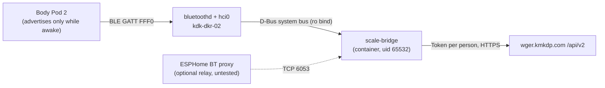

# scale-bridge (Body Pod 2 → wger)

A small Python service on kdk-dkr-02 that listens for the household scale (Hume
**Body Pod 2**, a Lefu OEM unit) over Bluetooth LE, decodes a weigh-in, works out whose
it is from a weight band, and writes it to that person's [wger](wger.md): body weight
plus the ten raw impedance values. It ships in **dry-run**: it logs what it would write
and posts nothing until the owner switches it on ([runbook](../runbooks/scale-bridge.md)).

No port, no UI, no Traefik router. It computes no body composition: the scale sends
weight and raw ohms only, and Hume's formulas are closed.



## At a glance

| Field | Value |
|---|---|
| Purpose | Body Pod 2 weigh-ins → wger body weight + raw impedance, per person |
| Host | kdk-dkr-02 (10.1.30.21), Komodo stack `scale-bridge` |
| Image | `kdk/scale-bridge:0.1.0`, built on the host from `stacks/scale-bridge` (python 3.12-slim, bleak, bleak-retry-connector, bleak-esphome, httpx from `uv.lock`) |
| Mode | `SCALE_BRIDGE_DRY_RUN: "true"` in compose until the owner flips it |
| Bluetooth | `/run/dbus:/run/dbus:ro` → host bluetoothd. No privileged, no capabilities, no `/dev`, bridge network |
| Host files | `/opt/kdk-lab/scale-bridge/scale-bridge.env` (people bands, optional address/proxies), `/opt/kdk-lab/scale-bridge/secrets.env` (wger keys, noise keys). Both root 600, host-managed |
| Storage | None. Nothing is spooled: a reading that cannot reach wger after 6 tries (about 30 min) is logged as lost |
| Blast radius | Down: weigh-ins are not recorded (weigh again later, or enter in the wger app). wger and HA are unaffected |

## How a weigh-in flows

1. The scale wakes when someone steps on and advertises as `Body Pod 2` with service
   `FFF0`. The bridge scans all the time and matches on that name (or, for a nameless
   passive advert, on `FFF0`), plus `SCALE_ADDRESS` if set.
2. Connect (bleak-retry-connector, 3 attempts, 30 s cap), subscribe `FFF4`, write the
   placeholder profile `FE 01 <sex> <activity> <height> <age> 01 <xor>` to `FFF1`, then
   subscribe `FFF2` (silent on our unit).
3. Collect frames. Every frame's last byte is the XOR of the others; a bad frame is
   counted and dropped.
   - **Settled weight** = the first `CF` frame with the stable bit and a non-zero weight.
     About 5 s later, as the load comes off, the scale sends another stable-flagged
     frame with weight 0: ignored, as is every `CF` after the lock.
   - Then up to 5 s for both `BE` frames (≈50 kHz, ≈250 kHz; five values each, order
     right arm, left arm, trunk, right leg, left leg per the protocol reference), then
     up to 1 s for the four `DF` frames (kept raw).
   - A lock without `BE` frames is still a reading (weight only). No lock = no reading.
     The handle must be held to the end for a lock (~20 s).
4. Disconnect, then ignore the scale for 60 s: on a second connection it replays the
   same weight.
5. Attribution: exactly one band containing the weight = that person. No band or two
   bands = warning, nothing written.
6. Dry-run: one `would_write` log line. Live: written to wger in the background, retried
   with backoff.

## What lands in wger (per person, their own token)

| wger | Value |
|---|---|
| Official **Body weight** category (`metric_type=body_weight`) | weight in kg, `extra_data.unit=kg` (correct even if the profile is in lb), `extra_data.df_raw` = the four `DF` frames as hex |
| 10 custom categories `Impedance 50 kHz right arm` … `Impedance 250 kHz left leg`, unit `ohm` | raw ohms, created by name on first use |

Every entry carries `source=user`, `notes="Body Pod 2 via scale-bridge"` and one
`external_id` per reading (uuid5 of scale address + lock time + person). wger keeps
`external_id` unique per category + source, and the bridge checks for it before posting,
so a retry never duplicates. If a person has never logged a weight (no official
category yet), the first weight goes through the legacy `weightentry/` endpoint (in the
profile's unit), which creates the category.

## Logs

One JSON line per event: `config`, `token_check` (status only), `scanning`, `session`
(counts, end reason, RSSI, masked address `..:XX:YY`), `attribution` (person or
candidates, never the weight), `would_write` (dry-run only: **the only line with the
weight**; impedances as a count), `wrote` / `write_failed` / `write_gave_up`. Tokens and
noise keys are never logged. Loki: `{container="scale-bridge"}`.

## Relay mode (optional, untested on hardware)

The scale lives in the basement, out of range of every lab host (2026-11-14 range
check). The plan is an ESP32 running the stock ESPHome **Bluetooth proxy** near the
scale. Set `SCALE_BRIDGE_ESPHOME_PROXIES=<ip>[=NOISE_ENV]` in `scale-bridge.env` and the
key in `secrets.env`: the bridge brings the proxy up with `bleak-esphome`
(`APIConnectionManager`), habluetooth routes the same bleak scanner/client through it,
and the local adapter is no longer used. Use the proxy's IP (no mDNS on the bridge
network); the proxy must allow active connections, and kdk-dkr-02 must reach its TCP
6053. Not tried with a real proxy.

## Verify

**kdk-dkr-02 (`ssh kdkadmin@10.1.30.21`)**

```bash
sudo docker ps --filter name=scale-bridge --format '{{.Names}} {{.Status}}'      # Up ... (healthy)
sudo docker logs --since 10m scale-bridge 2>&1 | grep -E '"event":"(config|token_check|scanning)"'
#   config dry_run true, token_check result ok per person, scanning transport local
```

## Troubleshooting

| Symptom | Cause | Fix |
|---|---|---|
| `config_invalid` and the container restarts | bad JSON in `SCALE_BRIDGE_PEOPLE` or a malformed `SCALE_ADDRESS` | fix `scale-bridge.env` (one line, single quotes), redeploy |
| Exits at start with a D-Bus error | `/run/dbus` socket missing or bluetoothd down | `systemctl status bluetooth` on dkr-02 |
| No `session` lines when someone weighs in | out of range (basement), a phone with the Hume app holds the scale, or wrong `SCALE_ADDRESS` | Bluetooth off on the phones; relay mode |
| `session` with `result: connect_failed` | weak signal or a phone connected first | as above |
| `session` with `settled: false` | handle released before the lock | hold the handle until the display locks |
| `attribution` `no_match` / `ambiguous` | bands miss the weight or overlap | widen/narrow the bands in `scale-bridge.env` |
| `token_check` `rejected` / `missing` | key revoked, or not in `secrets.env` | runbook step 2 |
| `write_gave_up` | wger unreachable for ~30 min | enter that weight in the wger app |

## Dependencies

| Needs | Why |
|---|---|
| bluetoothd on kdk-dkr-02 (BlueZ 5.82) | the radio; policy `bluetooth.conf` lets any uid send to `org.bluez` |
| [wger](wger.md) API (`/api/` has no Authelia) | where readings go |
| 1Password `wger-api-jmack`, `wger-api-rach` | per-person keys, copied into `secrets.env` by the runbook |

Sources: vault capture note `1. Projects/exercise/scale-sniff-2026-11-14.md`, design note
`scale-integration-options-2026-11-09.md` section (c); the public Blue2Scale
`BLE_SCALE_PROTOCOL.md`; wger 2.7 source (`wger/measurements`, `wger/weight`).
