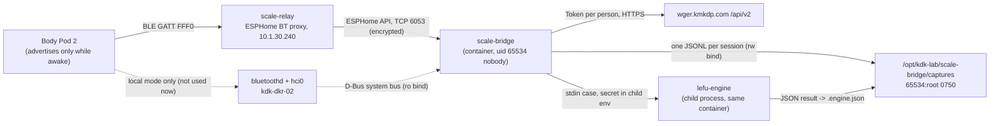

# scale-bridge (Body Pod 2 → wger)

A small Python service on kdk-dkr-02 that listens for the household scale (Hume
**Body Pod 2**, a Lefu OEM unit) over Bluetooth LE, decodes a weigh-in, works out whose
it is from a weight band, and writes it to that person's [wger](wger.md): body weight,
the heart rate and (since 0.3.0) the body-composition engine's results. The ten raw
impedance values are no longer written to wger since 0.3.1 (`SCALE_BRIDGE_WRITE_IMPEDANCE:
"false"`, [below](#raw-impedance-not-in-wger-since-031)). It also keeps a
**raw capture file per weigh-in** for paired tests against the vendor app. **Live writes** since
2026-11-16 (`SCALE_BRIDGE_DRY_RUN: "false"`); dry-run, which only logs what it would write, is
the rollback ([runbook step 6](../runbooks/scale-bridge.md#6-live-writes-dry-run-off)).

No port, no UI, no Traefik router. Since 0.2.0 it also runs **Lefu's own 8-electrode
body-composition engine** once per weigh-in (the scale vendor's published calculation
library, see [below](#body-composition-engine)); since 0.3.0 its results go to the captures
directory **and** to 16 custom `… (scale)` categories in wger
(`SCALE_BRIDGE_WRITE_ENGINE: "true"`), since 0.3.1 plus five derived `… (scale est.)` values
(`SCALE_BRIDGE_WRITE_DERIVED: "true"`, [below](#derived-values-in-wger)).



## At a glance

| Field | Value |
|---|---|
| Purpose | Body Pod 2 weigh-ins → wger body weight, heart rate and engine body composition, per person (raw impedance only in the capture files since 0.3.1) |
| Host | kdk-dkr-02 (10.1.30.21), Komodo stack `scale-bridge` |
| Image | `kdk/scale-bridge:0.3.1`, built on the host from `stacks/scale-bridge` (python 3.12-slim, bleak, bleak-retry-connector, bleak-esphome, httpx from `uv.lock`; plus the engine: jlink'd Temurin 21 JRE, unidbg, Lefu SDK, all sha256-pinned) |
| Engine | `SCALE_BRIDGE_ENGINE: "on"` in compose; self-disables without `LEFU_SECRET_8`. Results to `/captures/*.engine.json`, and with `SCALE_BRIDGE_WRITE_ENGINE: "true"` (since 0.3.0) to wger ([mapping](#engine-results-in-wger)) |
| Mode | **live**: `SCALE_BRIDGE_DRY_RUN: "false"` in compose since 2026-11-16 (`"true"` = log only, the rollback). Since 0.3.0 also `SCALE_BRIDGE_WRITE_HEART_RATE: "true"` and `SCALE_BRIDGE_WRITE_ENGINE: "true"`, since 0.3.1 `SCALE_BRIDGE_WRITE_DERIVED: "true"` and `SCALE_BRIDGE_WRITE_IMPEDANCE: "false"`. Each switch works on its own; code defaults are off, except impedance (on) |
| Bluetooth | `/run/dbus:/run/dbus:ro` → host bluetoothd, as uid `65534:65534` (host `nobody:nogroup`). No privileged, no capabilities, no `/dev`, bridge network |
| Relay | the scale is heard **only** through the ESPHome Bluetooth proxy `scale-relay` (10.1.30.240), since 2026-11-15; [below](#relay-scale-relay) |
| Host files | `/opt/kdk-lab/scale-bridge/scale-bridge.env` (people bands, `SCALE_ADDRESS`, `SCALE_BRIDGE_ESPHOME_PROXIES`), `/opt/kdk-lab/scale-bridge/secrets.env` (wger keys, `SCALE_RELAY_NOISE_KEY`). Both root 600, host-managed |
| Storage | `/opt/kdk-lab/scale-bridge/captures` → `/captures` (rw), `65534:root 0750`, created by the runbook before the deploy: raw capture files (health data, 0640, pruned after 60 days). Readings are not spooled: one that cannot reach wger after 6 tries (waits 30+60+120+240+480 s = 15.5 min) is logged as lost (`write_gave_up`) |
| Blast radius | Down, or the relay off: weigh-ins are not recorded (weigh again later, or enter in the wger app). wger and HA are unaffected |

## How a weigh-in flows

1. The scale wakes when someone steps on and advertises as `Body Pod 2` with service
   `FFF0`. The bridge scans all the time and matches on that name (or, for a nameless
   passive advert, on `FFF0`), plus `SCALE_ADDRESS` if set. Without `SCALE_ADDRESS` any
   nearby device with that name is accepted (startup logs `config_address_filter_off`);
   pinning it is a go-live step in the runbook.
2. Connect (bleak-retry-connector, 3 attempts, 30 s cap), subscribe `FFF4`, write the
   placeholder profile `FE 01 <sex> <activity> <height> <age> 01 <xor>` to `FFF1`, then
   subscribe `FFF2` (silent on our unit).
3. Collect frames. Every frame's last byte is the XOR of the others; a bad frame is
   counted and dropped.
   - **Settled weight** = the first `CF` frame with the stable bit and a non-zero weight.
     Every weight `CF` after it is ignored.
   - Then up to 5 s for both `BE` frames (≈50 kHz, ≈250 kHz; five values each, order
     right arm, left arm, trunk, right leg, left leg per the protocol reference), then
     up to 1 s for the four `DF` frames (kept raw).
   - Then up to 20 s (`SCALE_END_MARKER_WAIT_S`) for the **end-of-measurement marker**:
     a `CF` frame with the stable bit, weight 0 and state byte `00`, sent about 5 s after
     the lock as the load comes off, only when the handle was held. Byte 1 is the heart
     rate in BPM (0 = none). The session ends on the marker (`ended_by: end_marker`), a
     disconnect, or the wait (`end_marker_timeout`, heart rate none); either way the
     reading is complete. The vendor app appears to need this frame before it accepts a
     replayed weigh-in.
   - A lock without `BE` frames is still a reading (weight only, `impedance_timeout`, no
     marker wait). No lock = no reading; a marker before any lock (a step-off) is
     counted (`early_end_markers`) and changes nothing. The handle must be held to the
     end for a lock (~20 s). The 90 s session watchdog still caps everything.
4. Disconnect, then ignore the scale for 60 s: on a second connection it replays the
   same weight (and impedance). The cooldown is in memory only; after a restart the
   replay rule below is what keeps a replay from being written twice.
5. Attribution: exactly one band containing the weight = that person. No band or two
   bands = warning, nothing written. Bands are inclusive and given in pounds
   (`min_lb`/`max_lb`) or, still accepted, kilograms (`min_kg`/`max_kg`): one pair per
   person. Pounds are converted to kg once at startup; the comparison is in kg.
6. Dry-run: one `would_write` log line (`weight_kg` plus `weight_lb` to 0.1, to compare
   with the scale display; `heart_rate: true/false` = whether one was captured, never the
   value). Live (the current mode): written to wger in the background; a failed attempt
   (wger error, timeout, a non-JSON or unexpected body, or any other exception) is
   retried after 30 s, doubling, 6 tries in all (15.5 min of waits).

## What lands in wger (per person, their own token)

| wger | Value |
|---|---|
| Official **Body weight** category (`metric_type=body_weight`) | weight in kg, `extra_data.unit=kg` (correct even if the profile is in lb), `extra_data.df_raw` = the four `DF` frames as hex |
| 10 custom categories `Impedance 50 kHz right arm` … `Impedance 250 kHz left leg`, unit `ohm` — **off since 0.3.1**: `SCALE_BRIDGE_WRITE_IMPEDANCE: "false"` in compose (code default on) | raw ohms, created by name on first use; with the switch off no category is created and no row is written |
| custom category `Heart rate (scale)`, unit `bpm` — `SCALE_BRIDGE_WRITE_HEART_RATE: "true"` in compose since 0.3.0 (code default off) | the end marker's heart rate, same idempotence path as the impedance categories; nothing when the scale sent none. Never wger's own `Heart rate` category (Apple Health feeds that one) |
| 16 custom categories `Body fat (scale)` … `Lean left leg (scale)` — `SCALE_BRIDGE_WRITE_ENGINE: "true"` in compose since 0.3.0 (code default off) | the engine's results for that weigh-in, at the weight's time; [table](#engine-results-in-wger) |
| 5 custom categories `Mineral (scale est.)` … `Torso fat (scale est.)` — `SCALE_BRIDGE_WRITE_DERIVED: "true"` in compose since 0.3.1 (code default off) | values worked out from the same engine result, same time; the four with a fitted constant only for a male profile; [table](#derived-values-in-wger) |

Custom categories are looked up by exact name **and** `metric_type: custom`, so an official or
Apple Health category (`Body fat`, `Heart rate`, …) is never reused or written into.

Every entry carries `source=user`, `notes="Body Pod 2 via scale-bridge"` and one
`external_id` per reading: uuid5 of scale address + person + weight + the four `DF`
frames, or the lock time when the `DF` frames are missing. wger keeps `external_id`
unique per category + source, so posting the same id again is a 400 the bridge counts as
"exists".

**Same weigh-in, same entries (no state kept).** A reading whose weight (to 5 g) already
has a body-weight entry within 10 minutes is that weigh-in again: nothing new is posted
for the weight, and each impedance value is posted only if its category has no entry at
that entry's time. Covered by this rule: a retry after a timeout, and a replay after a
restart within 10 min (weight-only or with impedance, whether or not the `DF` bytes
repeat). Covered only if the scale re-sends identical `DF` bytes (not verified): a replay
more than 10 min later. Cost: a genuine second weigh-in by the same person within 10 min
at exactly the same weight is not written (after a weight-only lock it still gets the
missing impedance). `SCALE_BRIDGE_REPLAY_WINDOW_S` (600) sets the window. The rule rests on
the body-weight entry only, so it works the same with the impedance switch off; heart-rate,
engine and derived rows follow the same "entry at that time" check.

### Raw impedance not in wger (since 0.3.1)

Owner decision 2026-11-16: the ten raw ohm values cluttered wger's Measurements, so compose
sets `SCALE_BRIDGE_WRITE_IMPEDANCE: "false"` (code default `true`). A full weigh-in with heart
rate now writes `created: 2` (weight + heart rate) plus the engine and derived rows. The engine
is unaffected: its input is the reading's `DF` frames, never wger. The body-weight entry keeps
`extra_data.df_raw` (the four `DF` frames as hex) as before; nothing was added to it.
**The ten raw impedance values are now kept only in the capture files on the host, and those
are pruned after 60 days (`SCALE_BRIDGE_CAPTURE_KEEP_DAYS`): they are no longer kept anywhere
long-term.** The categories written before 0.3.1 stay in wger until deleted
([runbook 6d](../runbooks/scale-bridge.md#6d-raw-impedance-out-of-wger-031)).

If a person has never logged a weight (no official category yet), the first weight goes
through the legacy `weightentry/` endpoint (in the profile's unit). In wger 2.7 that
endpoint runs `get_or_create` on the official category and saves an ordinary measurement
at the posted time in the same request, so a retry after a timeout finds both and does
not post again (test `test_timeout_after_an_accepted_weightentry_post_does_not_duplicate`).

## Heart rate

**Status: confirmed on 6 of 6 paired weigh-ins, written to wger since 0.3.0.** Byte 1 of the
end-of-measurement marker equalled the heart rate the vendor app displayed for each paired
weigh-in (first one 2026-11-14). Byte 2 was `0xc0` on the first (the stable bit plus a flag of
unknown meaning); only the stable bit is used, and each capture file's footer records byte 2 raw
(`end_marker_byte2`). Owner approved writing it: compose `SCALE_BRIDGE_WRITE_HEART_RATE: "true"`
(code default off; `"false"` turns it off again).

## Body-composition engine

**What:** Lefu's 8-electrode calculation library (`ppcalculatekit` 4.6.28 +
`ppbasiccalculatekit` 1.1.1, MIT, from Lefu's public GitHub), the vendor library behind the
Hume app's numbers. It turns weight, height, age, sex and the ten encrypted impedances in the
scale's `DF` frames into body fat, muscle, water, BMR and so on. It runs inside the bridge's
own container as a child program (`lefu-engine`), once per weigh-in: the vendor's Java
wrapper on a small JRE, its arm64 native code inside unidbg (an emulated arm64 Android
process, Unicorn 2 CPU emulator). No Android, KVM, capability, device or network.

**Usage and licence:** personal, non-commercial use for the household only (owner decision
2026-11-14). It needs a secret; the one used is Lefu's published **demo** key, which the
library accepts because the engine reports the demo's package name. The key lives in
1Password (`lefu-engine-secret`) and the host's `secrets.env`, never in the repo or the
image. The image is built privately and never distributed, so its GPL-2.0 parts (Unicorn,
Keystone) and the JRE (GPL-2.0 + Classpath Exception) raise no obligation. Full list:
[stack README](https://github.com/BigH3ater/kdk-lab-dkr/blob/main/stacks/scale-bridge/README.md#third-party-software-in-the-image-personal-non-commercial-use).

**When it runs:** after the decision, before the capture is written, if all of these hold:
the engine is on (`SCALE_BRIDGE_ENGINE: "on"` and `LEFU_SECRET_8` set), the weight matched
exactly one person, that person has a profile in `SCALE_BRIDGE_PEOPLE`, and all four `DF`
frames arrived. Otherwise it is skipped (`engine_skipped`, reason `no_profile` /
`df_incomplete`). It never changes the weigh-in, the capture or the wger write of the raw
values: every failure is one log line with a reason code, and the weight is written
without engine rows.

**Inputs (known-good configuration, do not change unless testing):**

| Input | Value | Env |
|---|---|---|
| Variant | `PPDeviceCalcuteTypeAlternate8_4` | `LEFU_VARIANT: "8_4"` |
| `DF` decoding | per frequency index x: payload of sub-packet 0 (12 bytes) + sub-packet 1 (8 bytes) = five little-endian uint32 | fixed |
| Frequency mapping | `DF` x=0 = the library's 20 kHz input, x=1 = 100 kHz | `LEFU_DF_X0: "20k"` |
| Limb order | frame position per library slot LeftArm, RightArm, LeftLeg, RightLeg, Trunk = 1, 0, 4, 3, 2 (position 2 = trunk) | `LEFU_LIMB_ORDER: "10432"` |
| Weight | the settled weight (kg, 0.01) | — |
| Height | person's `height_cm`, truncated to whole cm | profile |
| Age | whole years on the measurement's local date, from `birth_date` (preferred) or `age` | profile |
| Sex | `male` / `female` | profile |

The secret goes into the child's environment only (the child gets nothing else from the
bridge's environment except `PATH`, `TZ` and the `LEFU_*` paths: no wger keys); the case goes
on stdin, never the command line; the child's stderr is discarded. Hard timeout
`SCALE_BRIDGE_ENGINE_TIMEOUT_S` (60 s; the child is killed).

**Output:** `<capture name>.engine.json` next to the raw capture (`.jsonl` replaced), 0640,
same pruning. One JSON document: `result` and `error_type`, `fields` (count), `input` (the
case sent), `provenance` (variant, limb order, frequency mapping, endianness, profile fields
used: whole-cm height, sex, age and where the age came from; weight; engine info: SDK repo +
commit + `.aar` versions, unidbg version, backend, arch; bridge version), `timings` (wall
time, engine init and calculation ms) and `output` (the engine's full JSON: every getter of
the vendor's result model, `errorType`, plus `base`, the input model with the library's
decrypted impedances). Written only when the engine returned a result (`ok`, or
`engine_error` with the library's error type); the capture footer records `engine` (reason
code, or null when not run) and `engine_result` (whether the file exists).

**Reason codes** (`engine` log line `result`, capture footer `engine`): `ok`, `engine_error`
(the library's `errorType` is not `PP_ERROR_TYPE_NONE`, e.g. `PP_ERROR_TYPE_SECRET`),
`timeout`, `nonzero_exit`, `calc_exception` (the calculation threw), `malformed_output`,
`spawn_failed`, `secret_in_output` (the output contained the secret: discarded), `crashed`.

### Engine results in wger

**Switch:** `SCALE_BRIDGE_WRITE_ENGINE` (compose `"true"` since 0.3.0, code default off;
independent of the heart-rate switch). Rows are written only when the bridge is live, the
weigh-in matched one person, and the engine result is `ok` with `errorType`
`PP_ERROR_TYPE_NONE`. One custom category per metric per person, created by name on first
use; each value gets its own row at the **same time as the weight entry** with the reading's
`external_id` (the impedance scheme) and `extra_data` `{unit, device, engine_field}`.

| wger category (custom) | Engine getter (`output.out`) | Unit |
|---|---|---|
| `Body fat (scale)` | `getPpFat` | `%` |
| `Skeletal muscle (scale)` | `getPpBodySkeletalKg` | mass |
| `Body water (scale)` | `getPpWaterPercentage` | `%` |
| `Visceral fat (scale)` | `getPpVisceralFat` | `index` |
| `BMR (scale)` | `getPpBMR` | `kcal` |
| `Bone mineral (scale)` | `getPpBoneKg` | mass |
| `ECW (scale)` | `getPpWaterECWKg` | mass |
| `ICW (scale)` | `getPpWaterICWKg` | mass |
| `Lean mass (scale)` | `getPpLoseFatWeightKg` (the vendor's "LBW", lean body weight) | mass |
| `Body cell mass (scale)` | `getPpCellMassKg` | mass |
| `BMI (scale)` | `getPpBMI` | `index` |
| `Lean right arm (scale)` | `getPpMuscleKgRightArm` | mass |
| `Lean left arm (scale)` | `getPpMuscleKgLeftArm` | mass |
| `Lean trunk (scale)` | `getPpMuscleKgTrunk` | mass |
| `Lean right leg (scale)` | `getPpMuscleKgRightLeg` | mass |
| `Lean left leg (scale)` | `getPpMuscleKgLeftLeg` | mass |
| not written | `getPpBodyAge` (metabolic age: not comparable to the app), `getPpBalanceFatArmLegLevel` and the other balance levels (not deterministic in the vendor library), subcutaneous fat, per-limb fat, `getPpMineralKg` (only through [`Mineral (scale est.)`](#derived-values-in-wger)), skeletal % | — |

The getters are the vendor result model's (`com.lefu.ppcalculate.PPBodyFatModel` in the pinned
`ppcalculatekit` 4.6.28), exported by name by `engine/src/kdk/lefu/Main.java` (`scalars`); the
units are the vendor's own (`assets/BodyParam_HT_8.json` in the same `.aar`). The table lives
in code as `ENGINE_METRICS` (`scale_bridge/wger.py`).

**Mass units.** wger does not convert a custom category's unit (it is a label), so a mass
metric is created in the person's wger profile weight unit (`kg` or `lb`); once a category
exists the bridge converts to **that category's** unit, so a later profile change never mixes
units in one category. A mass category with any other unit is skipped (`engine_skipped`).

**Values.** A metric whose value is missing, not a number, non-finite, zero or negative is
skipped and counted, never logged. Paired tests against the vendor app (six weigh-ins):
weight, visceral fat, bone mineral, ECW, ICW, body cell mass and body water % match the app
or within rounding; BMR is close; body fat reads 1.4 to 4.7 points **below** the app (the app
smooths toward its own history). The owner accepted the engine's own figures.

**Order and failures.** The weight (and the impedance when on, and the heart rate) are posted first; only then
does the write task wait for this weigh-in's engine result (the engine takes about 1.2 s on the
Pi and runs in parallel), bounded by `SCALE_BRIDGE_ENGINE_TIMEOUT_S` + 30 s. An engine that is
off, has no profile, fails or times out gives no engine rows and changes nothing else
(`engine_result` in the `wrote` line says why). The engine rows share the write's retries: a
wger error or timeout retries the whole write, and the replay rule turns what is already there
into `exists`, so a retry or a replay adds only the missing rows. A row wger refuses with a
plain 400 (a value it will not store) is counted as `engine_rejected` and the others go on: the
weight is not retried or lost for it.

### Derived values in wger

**Switch:** `SCALE_BRIDGE_WRITE_DERIVED` (compose `"true"` since 0.3.1, code default off). It
only has effect with `SCALE_BRIDGE_WRITE_ENGINE` on and an `ok` engine result. Five values the
vendor app shows but the engine does not output, worked out by the bridge from the same
`output.out`, written in the same pass as the engine rows: same time, `external_id`,
idempotence, replay rule, mass-unit rule and per-row 400 handling. `extra_data` is
`{unit, device, derived: true, formula}` (a short formula id) instead of `engine_field`.

| wger category (custom) | Formula (engine getters, kg) | Unit | Fit over 4 paired weigh-ins |
|---|---|---|---|
| `Mineral (scale est.)` | `getPpMineralKg - getPpBoneKg` | mass | within the app's one-decimal rounding (0.8 % spread) |
| `Android fat (scale est.)` | `0.780 * getPpBodyFatKgTrunk` | mass | 0.25 % spread while the app value moved 12 % |
| `Gynoid fat (scale est.)` | `1.422 * (getPpBodyFatKgLeftLeg + getPpBodyFatKgRightLeg)` | mass | 0.34 % spread while the app value moved 12.6 % |
| `A/G ratio (scale est.)` | `100 * android / gynoid` (the two values above) | `%` | 0.19 % spread |
| `Torso fat (scale est.)` | `100 * getPpBodyFatKgTrunk / (0.529 * getPpWeightKg)` | `%` | 0.26 % spread while the app value moved 11.5 % |

**Constants:** `0.780` (`ANDROID_PER_TRUNK_FAT`), `1.422` (`GYNOID_PER_LEG_FAT`), `0.529`
(`TORSO_SHARE_OF_WEIGHT`), with the table as `DERIVED_METRICS` in `scale_bridge/wger.py`.
Evidence: fitted on four paired weigh-ins of one male subject, 2026-11-15/16; provisional until
more paired weigh-ins. The six getters are public `float` getters of `PPBodyFatModel` in the
pinned `ppcalculatekit` 4.6.28 (`engine/sdk.lock`).

**Sex guard:** the four rows with a fitted constant (android, gynoid, A/G, torso) are written
only when the person's engine profile (`sex` in `SCALE_BRIDGE_PEOPLE`) is `male`; for any other
profile they are skipped and counted as `derived_skipped_sex`. `Mineral (scale est.)` has no
fitted constant and is written for everyone.

**Values:** a missing, non-finite, zero or negative input, or a result that is not a positive
finite number, skips that row (`derived_skipped`); A/G is skipped when android or gynoid is.

**Not reproduced** (app fields the bridge does not write): skeletal mass, metabolic age, the
vendor health score, per-limb fat %.

**Build:** Dockerfile stage `engine` downloads three `.aar` files from
`raw.githubusercontent.com/LefuHengqi/PPBaseKit-Android` at the commit in `engine/sdk.lock`
and 21 jars from `repo1.maven.org` listed in `engine/deps.lock` (the complete set, no Maven
resolution), checks every sha256, patches, compiles and jlinks. Measured on the x86_64
laptop: 1 min 9 s for the whole image natively, 5 min 20 s for arm64 under qemu (engine
stage 3 min of that); the engine stage peaks at about 580 MiB. The native Pi build is not
measured yet (expected between the two). Later builds reuse the cached stage unless `engine/`
or the base image changes. Downloads about 40 MB; adds about 113 MB to the image (JRE 59 MB,
engine 54 MB; image about 293 MB unpacked).

**Open risks (stated plainly):**

- **Unicorn 2 on the Pi:** running in the deployed container on kdk-dkr-02 (arm64, its
  16 KiB-page kernel) since 2026-11-15, `ok` results in about 1.1 to 1.2 s per weigh-in. Unicorn 1
  crashed intermittently in the prototype (SIGSEGV after 2–200 cases), which is why Unicorn 2
  is the default; a rare crash would show as `engine` `result: crashed` / `nonzero_exit` and
  costs only that weigh-in's engine rows.
- **Memory on the Pi is not recorded here.** On the x86_64 laptop one engine run (dummy
  secret) peaked the container at 76 MiB; the arm64 image under qemu-user reached the 256 MiB
  `mem_limit` (qemu's own overhead). `mem_limit` stays 256m; check `docker stats` against it
  ([runbook 5b](../runbooks/scale-bridge.md#5b-attended-first-engine-run)).
- **Emulation correctness:** identical to the vendor library in an Android emulator on two
  real captures, the full variant × limb-order matrix and a 2,304-case sweep (prototype);
  not proven for every input.
- **Vendor changes:** pinned commit and hashes mean nothing changes silently; a bump needs the
  prototype's acceptance check again.

## Raw capture files

**What for:** paired tests. Each real weigh-in is saved exactly as the scale sent it, then
replayed byte for byte to the vendor phone app from an emulator, so the bridge's decoding can
be compared with what the app shows.

**What:** one JSONL file per session that received at least one frame (reading or not), in
`SCALE_BRIDGE_CAPTURE_DIR` (`/captures` in compose; empty = off), named
`<UTC yyyymmddThhmmssZ>-<session id>.jsonl`:

| Record | Fields |
|---|---|
| header (first line) | `kind: "header"`, `schema: 1`, `session`, `started` (UTC), `scale` (masked `..:XX:YY`), `rssi`, `profile_hex` + `profile_written` (the placeholder profile sent to `FFF1`), `app_version` |
| one per notification, in arrival order | `t` (UTC ISO, milliseconds), `kind: "frame"`, `char` (`fff4` / `fff2`), `hex` (the exact bytes), `valid` (false + `error` for a bad length/checksum frame, which is kept) |
| footer (last line) | `ended_by`, `result`, `counts` (the `session` log counts), `frames`, `attribution` + `decision` + `person` (if matched), `heart_rate` (present or not), `end_marker_byte2`, `engine` (reason code or null), `engine_result` (whether `<name>.engine.json` exists) |

The frame records have the shape of the capture script's (`t`, `kind: "frame"`, `char`,
`hex`), which the emulator replays; it ignores the header and footer.

**Privacy:** the files are health data (weight, impedance and heart rate are in the hex, and
the footer names the person). Mode 0640 in a 0750 directory owned by 65534:root, so only root
and the container uid read them; never logged (the log line `capture_written` carries the
file name and frame count only), never in git (the repo is public). Kept
`SCALE_BRIDGE_CAPTURE_KEEP_DAYS` days (60; 0 = forever), pruned at startup and once a day.
Listing, copying and deleting: [runbook](../runbooks/scale-bridge.md#7-raw-capture-files).

**Directory missing or not writable:** Docker creates a missing bind source as an empty
`root:root 0755` directory on deploy (the deploy succeeds), which uid 65534 cannot write. The
bridge then logs **one** `capture_unavailable` error (`problem: missing` / `not_writable`),
runs on without capturing, and starts writing again by itself once the directory is fixed.

## Logs

One JSON line per event: `config`, `token_check` (status only), `capture` (on/off at
startup), `scanning`, `session` (counts, end reason, RSSI, masked address `..:XX:YY`,
`end_marker` / `heart_rate` as true/false), `capture_written` (file name, frame count),
`capture_pruned` (captures and engine files), `capture_unavailable` (error, once),
`engine_config` (startup: on/off and why, variant, limb order, frequency mapping, which people
have a profile, SDK commit; a warning when it is off for lack of the secret), `engine` (per
run: `result` reason code, `duration_s`, `error_type`, `fields` count, `exit_code`, engine
`init_ms`/`calc_ms`; never a value), `engine_skipped` (`no_profile` / `df_incomplete`),
`engine_file_failed` (error type), `attribution` (person or
candidates, never the weight), `would_write` (dry-run only: **the only line with the
weight**; impedances as a count), `wrote` (counts: `created`, `exists`, `categories_created`;
with `SCALE_BRIDGE_WRITE_ENGINE` also `engine_result` (`ok`, or why there are no rows:
`no_profile`, `engine_off`, `not_run`, `no_result`, or the engine reason code),
`engine_created`, `engine_exists`, `engine_skipped`, `engine_rejected`,
`engine_categories_created`; with `SCALE_BRIDGE_WRITE_DERIVED` and an `ok` result also
`derived_created`, `derived_exists`, `derived_skipped`, `derived_skipped_sex`,
`derived_rejected`, `derived_categories_created`; never a value, never the profile sex) / `write_failed` (warning) / `write_crashed`
(error: an unexpected exception, type only; retried like a failure) / `write_gave_up`
(error). Startup warnings: `config_bands_overlap` (names the overlapping people, never the
bands; not fatal, an ambiguous weight is still written nowhere), `config_address_filter_off`.
Tokens, noise keys, the engine secret, profiles, engine inputs and engine results are
never logged. Loki: `{container="scale-bridge"}`.

## Security notes

- Runs as uid/gid `65534` (host `nobody:nogroup`), non-root, `cap_drop: ALL`,
  `no-new-privileges`, read-only root, `/tmp` tmpfs, no `/dev`, no host network, no port.
- **D-Bus:** `/run/dbus:/run/dbus:ro` hands the container the host's whole **system bus**
  socket, not just BlueZ. `:ro` only stops writes to the directory; connecting to the
  socket still works. What the container can do there is whatever the host's D-Bus
  policy allows an unprivileged uid: BlueZ's `bluetooth.conf` lets any uid call
  `org.bluez` (so it can drive the adapter: scan, connect, pair, power, for any nearby
  device), and other system services answer the calls their own policy allows any user
  (typically reads and introspection; privileged methods behind polkit are refused for
  `nobody`, which has no session). Not audited per service on kdk-dkr-02.
- Why accepted: it is the same mount Home Assistant uses, the uid is unprivileged, and
  the code only talks to `org.bluez` through bleak. Narrowing it would need a filtering
  proxy (e.g. `xdg-dbus-proxy` with `--talk=org.bluez`), left for a later change.

## Relay (`scale-relay`)

The scale is out of range of every lab host (2026-11-14 range check), so since
2026-11-15 22:11 UTC the bridge hears it **only** through an ESPHome Bluetooth proxy:
startup logs `relay_start` `result: connected` and `scanning` `transport: esphome`,
`proxies: 1`. The bridge depends on it: relay off = no weigh-ins recorded.

| Field | Value |
|---|---|
| Device | Waveshare ESP32-S3-ETH with the PoE module: wired Ethernet only (W5500 over SPI), no Wi-Fi. ESPHome 2026.6.5, `bluetooth_proxy` with `active: true` (it connects, not only listens) |
| Address | `10.1.30.240` (DHCP reservation, same VLAN as kdk-dkr-02), ESPHome API on TCP 6053, encrypted. The bridge uses the IP (no mDNS on its network) |
| Where | for now next to the scale; final place a bracket behind the bedroom TV (not built yet) |
| Config | [`stacks/scale-bridge/esphome/scale-relay.yaml`](https://github.com/BigH3ater/kdk-lab-dkr/blob/main/stacks/scale-bridge/esphome/scale-relay.yaml); build and flash: [runbook "Relay"](../runbooks/scale-bridge.md#relay-scale-relay) |
| Secrets | 1Password `op://kdk-cluster/scale-relay-esphome`: `credential` = API encryption (noise) key, `ota_password` = OTA password. The key is also in the host's `secrets.env` as `SCALE_RELAY_NOISE_KEY` |
| Bridge wiring | `scale-bridge.env`: `SCALE_BRIDGE_ESPHOME_PROXIES=10.1.30.240=SCALE_RELAY_NOISE_KEY` (format `host[=NOISE_ENV][,host2[=NOISE_ENV2]]`) and `SCALE_ADDRESS` pinned to the scale |

How it works: the bridge brings the proxy up with `bleak-esphome` (`APIConnectionManager`),
habluetooth routes the same bleak scanner and client through it, and the local adapter is
not used. Checked with two real weigh-ins end to end (2026-11-15 and 2026-11-16: connect
0.6 s and 0.1 s). The signal at the relay is weak in its temporary spot (RSSI about
-75 to -79 dBm); recheck after the move. With `SCALE_ADDRESS` pinned the bridge ignored
another device advertising the same name, through the relay too.

## Verify

**kdk-dkr-02 (`ssh kdkadmin@10.1.30.21`)**

```bash
sudo docker ps --filter name=scale-bridge --format '{{.Names}} {{.Status}}'      # Up ... (healthy)
sudo docker logs --since 10m scale-bridge 2>&1 | grep -E '"event":"(config|token_check|scanning)"'
#   config dry_run false, address_filter true; token_check result ok per person
sudo docker logs scale-bridge 2>&1 | grep -E '"event":"(relay_start|scanning)"' | tail -2
#   relay_start proxy 10.1.30.240 result connected; scanning transport esphome, proxies 1
```

## Troubleshooting

| Symptom | Cause | Fix |
|---|---|---|
| `config_invalid` and the container restarts | bad JSON in `SCALE_BRIDGE_PEOPLE` or a malformed `SCALE_ADDRESS` | fix `scale-bridge.env` (one line, single quotes), redeploy |
| Exits at start with a D-Bus error | `/run/dbus` socket missing or bluetoothd down | `systemctl status bluetooth` on dkr-02 |
| `fatal` `ConnectionResetError` `[Errno 104]` right after `config` | the container uid has no passwd entry on the host, so dbus-daemon drops the connection (seen with 65532 on the first deploy) | run as a uid that exists on the host: compose `user: "65534:65534"` (`getent passwd 65534` = `nobody`) |
| `config_invalid` naming `min_lb`/`min_kg` | a person has both pairs, a mixed pair (`min_lb` + `max_kg`) or half a pair | one pair per person, both ends in the same unit |
| No `session` lines when someone weighs in | relay off or out of range, a phone with the Hume app holds the scale, or wrong `SCALE_ADDRESS` | check `relay_start` / `scanning` ([Verify](#verify)); Bluetooth off on the phones |
| `relay_start` `result: waiting` or `failed` | the relay is off, unplugged, or not at 10.1.30.240; or the noise key does not match | [runbook "Relay"](../runbooks/scale-bridge.md#relay-scale-relay); the bridge keeps retrying by itself |
| `config_invalid` naming a noise key env | `SCALE_RELAY_NOISE_KEY` missing or empty in `secrets.env` | [runbook step 2](../runbooks/scale-bridge.md#2-secretsenv-from-1password) |
| `session` with `result: connect_failed` | weak signal or a phone connected first | as above |
| `session` with `settled: false` | handle released before the lock | hold the handle until the display locks |
| `session` `ended_by: end_marker_timeout` | impedance came but no end marker within 20 s (handle released early, or the scale did not send it) | a complete reading without heart rate; nothing to fix unless it is every time |
| `capture_unavailable` at startup | `/opt/kdk-lab/scale-bridge/captures` missing (Docker made it root 0755) or wrong owner | [runbook step 1](../runbooks/scale-bridge.md#1-host-directories); no restart needed |
| `attribution` `no_match` / `ambiguous` | bands miss the weight or overlap | widen/narrow the bands in `scale-bridge.env` |
| `token_check` `rejected` / `missing` | key revoked, or not in `secrets.env` | runbook step 2 |
| `write_gave_up` | wger failing for all 6 tries (15.5 min of waits) | enter that weight in the wger app |
| `write_crashed` | an unexpected exception in a write attempt (bug or an odd wger response) | it retries by itself; if it repeats, open an issue with the `error` type |
| `config_bands_overlap` at startup | two people's bands share a weight | fix the bands in `scale-bridge.env`; until then such a weight is written nowhere |
| `engine_config` `enabled: false`, `reason: no_secret` | `LEFU_SECRET_8` not in `secrets.env` | [runbook step 2b](../runbooks/scale-bridge.md#2b-engine-secret-lefu_secret_8); everything else works meanwhile |
| `engine_skipped` `no_profile` | that person has no `height_cm`/`sex`/`birth_date` in `SCALE_BRIDGE_PEOPLE` | [runbook step 3](../runbooks/scale-bridge.md#3-scale-bridgeenv-people-bands) |
| `engine` `result: engine_error`, `error_type: PP_ERROR_TYPE_SECRET` | wrong or truncated secret | redo step 2b from 1Password; check the length |
| `engine` `result: timeout` / `nonzero_exit` / `calc_exception` | engine slow, crashed or threw (Unicorn on the Pi) | weigh-ins unaffected; `SCALE_BRIDGE_ENGINE: "off"` if it repeats, then open an issue with the reason code |
| `wrote` with `engine_result` not `ok` | engine off, no profile, `DF` frames missing (`not_run`), engine failed (its reason code) or slower than its timeout + 30 s (`no_result`) | the weight (and heart rate) are in wger; see the `engine` / `engine_skipped` line of that session |
| `wrote` with `engine_rejected` > 0 | wger refused one value with a 400 | the other rows are in; open an issue with the count (the value is in that capture's `.engine.json`) |
| `config_invalid` naming a profile field | partial profile, both `birth_date` and `age`, bad date, sex not `male`/`female` | fix that person in `scale-bridge.env` |

## Dependencies

| Needs | Why |
|---|---|
| bluetoothd on kdk-dkr-02 (BlueZ 5.82) | the radio; policy `bluetooth.conf` lets any uid send to `org.bluez`, but dbus-daemon only accepts a connection from a uid that resolves on the host (hence `nobody` 65534) |
| [wger](wger.md) API (`/api/` has no Authelia) | where readings go |
| 1Password `wger-api-jmack`, `wger-api-rach` | per-person keys, copied into `secrets.env` by the runbook |
| 1Password `lefu-engine-secret` (optional) | the engine's `LEFU_SECRET_8`, copied into `secrets.env` by the runbook |
| Build: `raw.githubusercontent.com`, `repo1.maven.org` (plus Docker Hub / ghcr.io for the base images) | engine inputs, sha256-pinned (`engine/sdk.lock`, `engine/deps.lock`); nothing at run time |

Sources: vault capture note `1. Projects/exercise/scale-sniff-2026-11-14.md`, design note
`scale-integration-options-2026-11-09.md` section (c), `hume-app-results-2026-11-14.md` (heart
rate, end marker), `hume-metrics-reproduction-2026-11-14.md` (engine prototype and acceptance);
the public Blue2Scale
`BLE_SCALE_PROTOCOL.md`; wger 2.7 source (`wger/measurements`, `wger/weight`).
